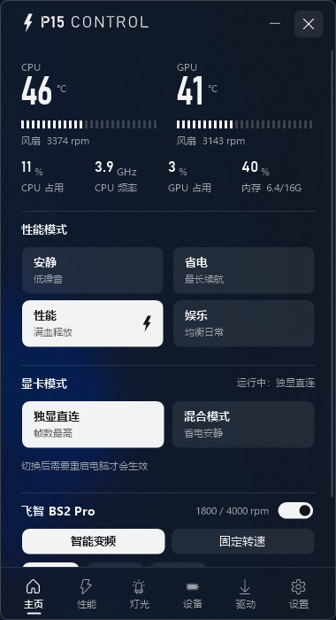
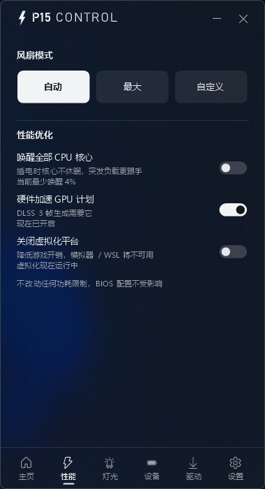
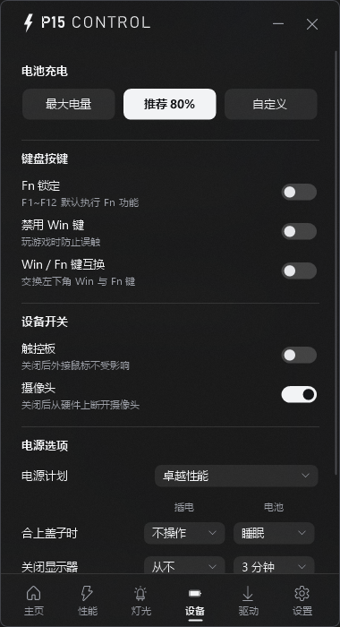
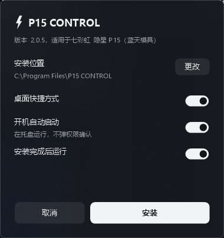
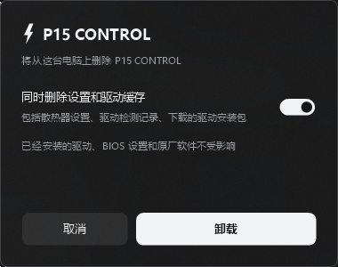
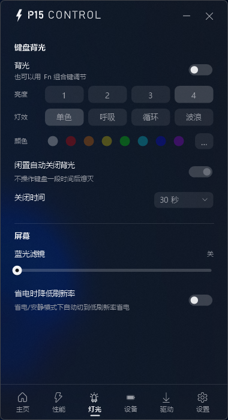
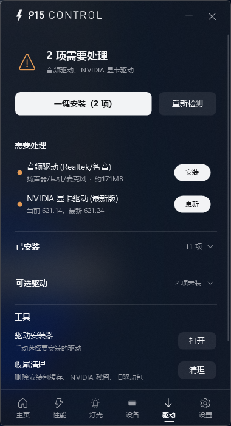
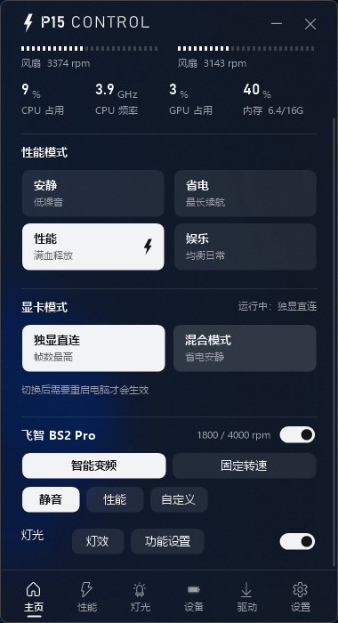

# P15 CONTROL

七彩虹 隐星 P15（蓝天模具）的轻量控制中心，用来替代原厂控制中心的界面。

- **很轻**：常驻托盘时 CPU 约 0.03%，内存约 15–20 MB；打开窗口约 34 MB，0.3 秒内打开。
- **只走原厂通道**：性能模式完全按原厂流程切换，不写入任何功耗限制，BIOS 里调过的功耗配置照常生效。
- **装上就能用**：一个约 1.4 MB 的安装包，自带硬件接口和原厂 ACPI 驱动，**不需要原厂控制中心**，不需要装任何运行库，自带卸载。
- **黑色透明磨砂玻璃界面**，手机屏大小（380 × 700）。

<p align="center">
  
  
  
</p>

---

## 目录

- [支持的机型](#支持的机型)
- [系统要求](#系统要求)
- [下载与安装](#下载与安装)
- [功能详解](#功能详解)
  - [主页](#主页) · [性能](#性能) · [灯光](#灯光) · [设备](#设备) · [驱动](#驱动) · [设置](#设置) · [托盘](#托盘)
  - [飞智 BS2 / BS2 Pro 散热器（可选插件）](#飞智-bs2--bs2-pro-散热器可选插件)
- [资源占用](#资源占用)
- [安全性说明](#安全性说明)
- [从源码构建](#从源码构建)
- [工作原理](#工作原理)
- [免责声明](#免责声明)

---

## 支持的机型

| 机型 | 状态 | 说明 |
|---|---|---|
| **七彩虹 隐星 P15 23**<br>（蓝天 P15 23 主板，i5-12450H + RTX 4050 Laptop） | ✅ 已完整实测 | 所有功能都在这台机器上验证过 |
| 其它装有蓝天原厂 **Control Center 3.0 / Fn hotkeys and OSD** 的蓝天模具笔记本 | ⚠️ 未测试 | 硬件接口相同。程序会按 BIOS 声明的能力自动显示或隐藏功能（显卡模式、CPU 动态加速、充电保护、键盘锁等），但不同 BIOS 的命令可能有差异，请先观察读数是否正常 |
| 非蓝天模具的笔记本（同方、广达、仁宝、华硕、联想等） | ❌ 不支持 | 硬件接口完全不同 |

**驱动页**只适配七彩虹 隐星 P15 23：驱动安装器用的是七彩虹官网为这款机型提供的驱动包。

**怎么判断是不是蓝天模具**：在 PowerShell 里运行下面的命令，能列出设备就是。

```powershell
Get-PnpDevice -InstanceId 'ACPI\CLV000*'
```

也可以在设备管理器里查看设备的硬件 ID，PCI 子系统厂商是 `1558`（Clevo）。

---

## 系统要求

| 项目 | 要求 |
|---|---|
| 系统 | Windows 10 22H2 或 Windows 11，64 位 |
| 运行库 | .NET Framework 4.8（Windows 10/11 自带，不用另装） |
| 原厂软件 | **不需要**。安装包自带硬件接口 `InsydeDCHU.dll` 和原厂 ACPI 驱动 AcpiBridge（微软签名）；这台电脑的 `ACPI\CLV0001` 设备没有驱动时（比如重装系统后），安装时会自动装上。<br>只有两样东西仍然靠原厂 Fn 热键程序：Fn 组合键本身（比如 Fn+数字键切换模式），以及「省电时降低刷新率」。需要的话可以在「驱动」页安装「原厂底层服务」 |
| 权限 | 安装和运行都需要管理员权限；开机自启用计划任务实现，开机时不会弹权限确认 |
| 透明效果 | 磨砂玻璃需要打开 Windows「设置 → 个性化 → 颜色 → 透明效果」 |

---

## 下载与安装

1. 在 [Releases](../../releases) 下载 `P15CONTROL-Setup-x.y.z.exe`。
2. 运行它，选择（如果这台电脑的原厂 ACPI 驱动缺失，会一并自动装上）：
   - 安装位置（默认 `C:\Program Files\P15 CONTROL`）
   - 是否创建桌面快捷方式
   - 是否开机自动启动
   - 装完是否立即运行
3. **更新**：直接运行新版安装包。会自动关闭正在运行的旧版本再覆盖，设置都会保留。

<p align="center"></p>

**卸载**：在「设置 → 应用 → 已安装的应用」里找到 **P15 CONTROL** 点卸载。
- 卸载会删除：程序文件、开始菜单和桌面快捷方式、开机自启任务、卸载信息。
- 勾选「同时删除设置和驱动缓存」时，还会删除：散热器设置、驱动检测记录、下载的驱动安装包。
- 不会动：已经安装的驱动、BIOS 设置、原厂软件。

<p align="center"></p>

---

## 功能详解

### 主页

| 功能 | 说明 |
|---|---|
| **CPU / GPU 温度** | 大号读数加刻度格（0–100°C），85°C 以上变成橙色；下面显示两个风扇的转速 |
| **系统占用** | CPU 占用、CPU 实际频率（和任务管理器的算法一致）、GPU 占用、内存。只在窗口可见时采样，最小化时暂停 |
| **性能模式** | 安静 / 省电 / 性能 / 娱乐。BIOS 收到的命令**和原厂完全一样**（WMI 121 / 子命令 25），所以 BIOS 里的功耗设定在各个模式下都照常生效。原厂 Fn 热键程序在运行时交给它执行，没有原厂软件时由本程序直接发送同一条命令 |
| **CPU 动态加速** | 原厂选项，只在 BIOS 声明支持时才显示，并且只在性能模式下可用 |
| **显卡模式** | 独显直连 / 混合模式（MUX 切换），按 BIOS 支持的模式显示，切换后需要重启。右上角显示当前实际运行的模式；设置了但还没重启时，会提示并给出「立即重启」按钮 |
| **散热器卡片** | 装了飞智散热器插件后显示在主页最下面，见[散热器](#飞智-bs2--bs2-pro-散热器可选插件)一节 |

### 性能


**风扇模式**
- **自动**：原厂默认的温控。
- **最大**：风扇全速。
- **自定义**：CPU 风扇、GPU 风扇各一条曲线，拖动两个圆点设置「多少度时转多快」，点「保存并应用」生效。只有选了自定义，曲线编辑才会显示出来。

**性能优化**（每一项都显示当前实际状态，需要重启的会提示）
- **唤醒全部 CPU 核心**：插电时处理器核心不休眠（Windows 电源计划里「最少不休眠核心」设为 100%），突发负载响应更快。只影响插电状态。
- **硬件加速 GPU 计划（HAGS）**：DLSS 3 帧生成需要它。
- **关闭虚拟化平台**：设置 `hypervisorlaunchtype off`，降低游戏的 CPU 开销。代价是 WSL2、安卓模拟器、Windows 沙盒、Docker 等不能用；关闭前会确认，随时可以改回来。
- 以上**都不涉及任何功耗限制**。

<br clear="right">

### 灯光



**键盘背光**
- 开关、亮度 4 档、灯效（单色 / 呼吸 / 循环 / 波浪）。
- 颜色：8 种常用色，或用「…」自选任意颜色。
- 闲置自动关闭，时间可选 15 秒到 10 分钟。
- 背光关闭时，相关选项会自动置灰。

**屏幕**
- **蓝光滤镜**：10 级，和原厂一样用调整屏幕色彩的方式实现。外接显示器插拔、换分辨率之后会自动重新应用。
- **省电时降低刷新率**：切到省电或安静模式时，自动把屏幕降到低刷新率（这一项由原厂 Fn 热键程序执行，没装原厂软件时会置灰）。

<br clear="right">

### 设备


**电池充电**
- **最大电量**：充满到 100%。
- **推荐 80%**：低于 70% 开始充，充到 80% 停止，适合长期插电使用。
- **自定义**：自己选开始充电和停止充电的电量。只有选了自定义，这两个选项才会显示出来。

**键盘按键**：Fn 锁定、禁用 Win 键、Win / Fn 键互换。按 BIOS 支持情况显示。

**设备开关**
- **触控板**：停用或启用触控板设备，外接鼠标不受影响。
- **摄像头**：从硬件上断开摄像头。

**电源选项**
- 切换电源计划。
- Windows 电源模式（节能 / 平衡 / 性能），在「平衡」计划下可用。
- 合上盖子时、关闭显示器、进入睡眠：插电和电池分别设置。

<br clear="right">

### 驱动



驱动功能是**可选组件**，内置在控制中心里：
- 第一次打开驱动页时只有一个「获取驱动组件」按钮，点了才会释放出驱动安装器，不需要联网。
- 驱动装完以后可以点「删除驱动组件」，会把安装器、下载缓存、安装记录、NVIDIA 安装残留全部删干净，需要时再获取。

驱动页的行为：
- **手动检测**：打开驱动页只显示上次检测的结果，点「检测驱动 / 重新检测」才会检测。
- 结果按「需要处理 / 已安装 / 可选」分组；缺失的必装和推荐驱动可以「一键安装」。
- **收尾清理**：直接在控制中心里完成。会删除驱动安装包缓存、NVIDIA 安装残留，以及驱动库里被新版本取代的旧驱动包（正在使用的会自动跳过）。

驱动安装器包含以下驱动：

| 分组 | 驱动 | 来源 | 说明 |
|---|---|---|---|
| 必装 | 芯片组、原厂底层服务（Fn 热键 / ACPI）、无线网卡 AX211、蓝牙、有线网卡 RTL8168、音频（Realtek / 智音）、英特尔串行 IO | 七彩虹官网 | 原厂底层服务提供 Fn 组合键、性能模式、显卡切换和本程序的硬件接口 |
| 推荐 | **NVIDIA 显卡驱动** | NVIDIA 官网最新版 | 不用原厂的老版本；只装显示驱动、HD 音频和 PhysX，不装 NVIDIA App |
| 推荐 | **英特尔核显驱动（UHD）** | Intel 官方 32.0.101.7092 | 只装驱动本体（`iigd_dch.inf`），不装 Intel 显卡控制中心。独显直连时核显被隐藏，驱动先放进系统驱动库，切到混合模式后自动生效 |
| 推荐 | 英特尔动态调谐 DTT、英特尔 HID 事件筛选器 | 七彩虹官网 | 分别影响性能释放和部分热键 |
| 可选 | 英特尔管理引擎 ME、英特尔 GNA、SBC 音效软件、Creative 音效 APP | 七彩虹官网 | 不装也不影响正常使用 |

安装器还有这些机制：
- 下载支持断点续传，并校验文件大小和 MD5。
- 解压优先用系统自带的 tar。tar 解不开的包会临时取出 7-Zip 的解压组件来用：直接从 7-Zip 官网的安装包里取出 `7z.exe` 和 `7z.dll`，不运行它的安装程序、不装进系统，收尾清理时一起删除。

<br clear="right">

### 设置

- **透明度**：轻透 / 标准 / 通透，调的是磨砂玻璃色调的深浅。
- **开机自动启动**：用计划任务、最高权限运行，登录后在托盘启动，不弹权限确认。程序挪了位置会自动修正。
- **关闭时最小化到托盘**：关掉后，点关闭就直接退出程序。
- **扩展功能**：安装或卸载飞智散热器插件。
- **关于**：版本号、原厂 Fn 热键程序和硬件接口的状态。

### 托盘

- 单色闪电图标，跟随任务栏深浅色：**实心表示性能模式，描边表示其它模式**。
- 左键打开主窗口；右键菜单可以快速切换四种性能模式，或者退出。
- 关闭窗口时整个窗口会被销毁，后台只留托盘图标、散热器调速和蓝光滤镜。

### 飞智 BS2 / BS2 Pro 散热器（可选插件）



如果你在用飞智 BS2 / BS2 Pro 笔记本散热器，可以用这个插件代替「飞智空间站」。

- **按需安装**：第一次打开控制中心时会问你要不要；不要就完全不加载，不占任何资源。以后可以在「设置 → 扩展功能」里安装或卸载。
- **连接**：通过蓝牙 LE。先在 Windows 蓝牙设置里配对好散热器。
- **智能变频**
  - 静音 / 性能：使用飞智官方曲线，并按 5V / 9V / 20V 供电自动适配最高转速。
  - 自定义：8 个点的温度—转速曲线。
  - 按 CPU / GPU 中较高的温度调速；升温立即跟随，降温超过 2°C 才降速，风扇不会来回变速。
- **固定转速**：1300 – 4000 rpm 任选，不超过当前供电允许的最高转速。
- **灯效**：纯色、呼吸、彩虹流光、单色旋转、随温度变色，可调亮度和速度。
- **功能设置**：通电自启、智能启停（关闭 / 即时运行 / 延时运行）、档位灯显示、开机自动连接。
- **后台也能调速**：关掉窗口后，托盘里照样按温度调速。
- 如果飞智空间站的服务正在运行，会提示你停用它，避免两边抢控制权。

<br clear="right">

---

## 资源占用

在七彩虹 隐星 P15 23 上实测：

| 状态 | CPU | 内存（工作集） |
|---|---|---|
| 托盘常驻（含散热器后台调速） | ≈ 0.03% | ≈ 15–20 MB |
| 打开窗口，停在主页 | ≈ 0.13% | ≈ 34 MB |
| 每页都打开过 | — | ≈ 44 MB |
| 窗口最小化 | 和托盘状态相同（停止采样） | — |
| 打开窗口耗时 | — | ≈ 0.3 秒 |

做到这么轻，主要靠这些设计：
- 页面第一次打开时才创建。
- 系统监控只用 Windows 原生接口（PDH、powrprof、SetupAPI），不加载 WMI 和 .NET 性能计数器。
- 读传感器放在后台线程，不卡界面。
- 关掉窗口后整个窗口销毁，并主动回收内存。
- 磨砂玻璃由系统合成（DWM 亚克力），本程序不做任何模糊计算。

---

## 安全性说明

- **不写入任何功耗限制**：不写 MSR、不调用 XTU、不改 DTT 策略，也不改电源计划里的处理器功耗参数。
- **性能模式只用原厂命令**：BIOS 收到的是原厂 Fn 热键程序发送的同一条命令（WMI 121 / 子命令 25，数据为模式号），由 BIOS 自己应用各模式的功耗策略。所以 BIOS 里调整过的 PL1 / PL2 等配置不会失效。
- **所有硬件指令都来自原厂软件**：显卡模式、风扇、键盘、充电等，用的都是原厂软件本身使用的接口和数值，没有自创指令。
- **只在你主动开启时才改系统设置**：「性能优化」里的选项不碰就不改。
- **兼容性提示**：在没有测试过的机型上，建议先看各项读数是否正常，再使用写入类的功能。

---

## 从源码构建

需要 [.NET SDK](https://dotnet.microsoft.com/download)。只用到其中的 Roslyn 编译器，生成的程序运行在系统自带的 .NET Framework 4.8 上。

```powershell
.\build.ps1
```

输出：
- `out\P15控制中心.exe`：控制中心本体，内置压缩的驱动安装器和散热器插件；旁边是硬件接口 `InsydeDCHU.dll`（来自 `lib\`）。
- `dist\P15CONTROL-Setup-<版本>.exe`：安装包，同时也是卸载程序；内置控制中心、硬件接口和原厂 ACPI 驱动（来自 `lib\acpibridge\`）。

散热器插件编译时需要 `Windows.winmd`（WinRT 元数据）。仓库里不附带这个微软的文件，`build.ps1` 会依次查找：
1. `lib\Windows.winmd`
2. 原厂控制中心目录 `C:\Program Files (x86)\ControlCenter\Windows.winmd`

两处都没有时，会跳过散热器插件，其余部分照常编译。

```
src/
  Common/     界面（Ui / Glass / Brand）、硬件接口 Dchu、驱动清单与检测、清理、系统监控
  Center/     控制中心：主窗口、托盘、设置、性能优化、插件加载
  Cooler/     飞智散热器插件（蓝牙 LE 协议、调速引擎、弹窗）
  Setup/      驱动安装器
  Installer/  安装 / 卸载程序
tools/        编译时生成图标
```

---

## 工作原理

- **硬件接口**：调用原厂的 `InsydeDCHU.dll`（Insyde DCHU），通过 ACPI / WMI 和 BIOS / EC 通信。
  - 安装包把它放在程序目录，程序优先用这一份；
  - 程序目录里没有时，再去原厂「Fn hotkeys and OSD」应用或原厂 Control Center 的目录里找一份带完整接口的版本。
- **性能模式**：原厂 Fn 热键程序在运行时，写入原厂事件日志通道（`OutLog`）由它执行，和原厂控制中心的做法相同；没有原厂程序时，直接发送它会发送的同一条 BIOS 命令（WMI 121 / 子命令 25），并把当前模式记到原厂设置里。
- **显卡模式**：读写 BIOS 的显卡模式设置，按 BIOS 声明支持的模式显示，重启后生效。
- **散热器**：飞智 BS2 Pro 的蓝牙 LE 协议，帧格式为 `5A A5 cmd len payload sum`；散热器每 0.5 秒主动上报一次转速和状态。

---

## 免责声明

- 本项目**不是**七彩虹（Colorful）、蓝天（Clevo）、Insyde、飞智（Flydigi）、NVIDIA 或 Intel 的官方软件，和这些公司没有任何关系。文中提到的商标归各自的所有者。
- 为了装上就能用，仓库和安装包附带了原厂的硬件接口文件 `lib/InsydeDCHU.dll` 和原厂 ACPI 驱动 `lib/acpibridge/`（AcpiBridge 1.0.0.9，微软 WHQL 签名）。它们的版权归 Insyde / 蓝天所有，只用来和本机 BIOS 通信；如果权利人要求，会立即移除。
- 驱动只在你点安装时才从厂商官网下载，本项目不分发任何驱动程序。
- 修改硬件设置有一定风险，请自行承担。在未测试的机型上使用前，请先确认机型兼容。

## 许可证

[MIT](LICENSE)
